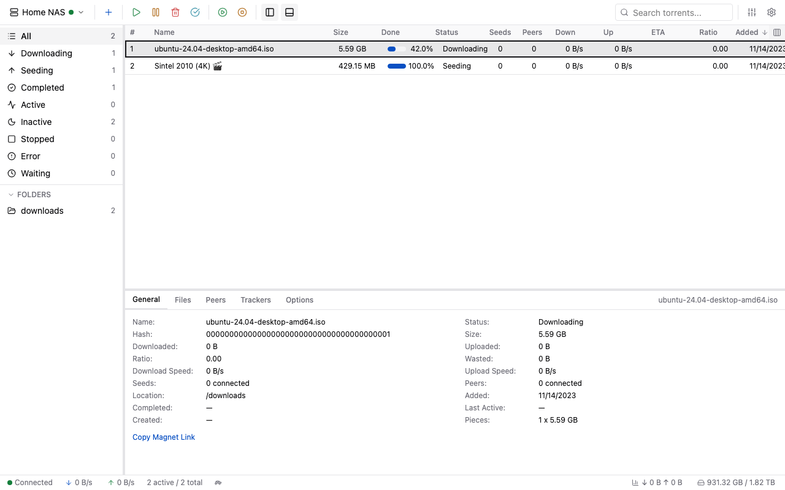
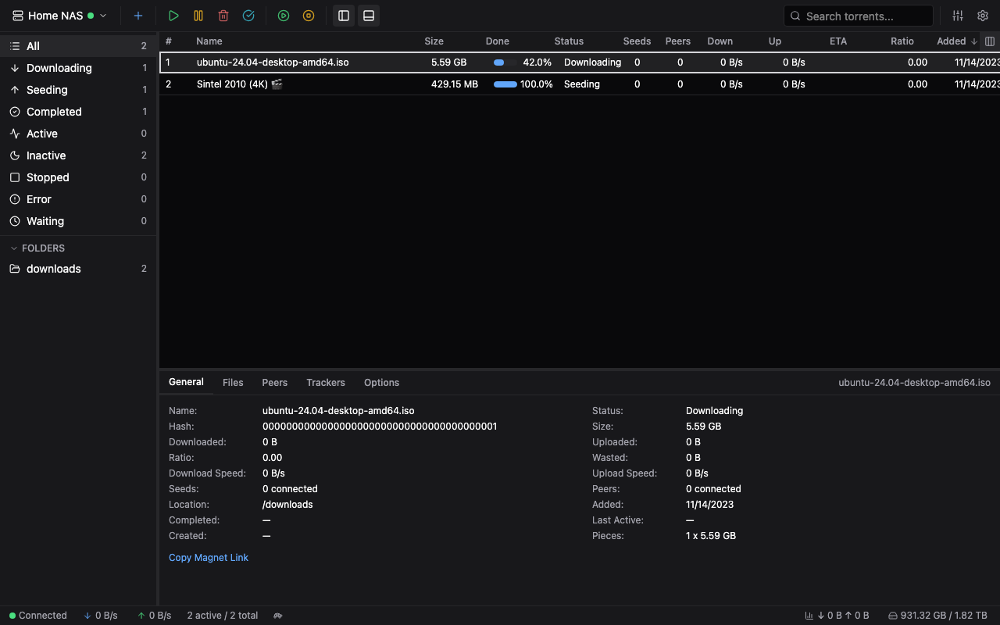
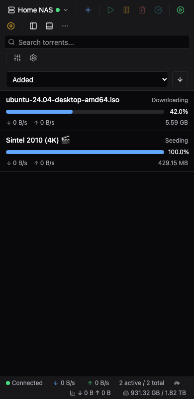

# Seedora

[](LICENSE)
[](https://github.com/CorentinGC/transmission-seedora/releases)

A cross-platform application to remotely manage a [Transmission](https://transmissionbt.com/) 4+ BitTorrent daemon. One shared React UI ships as a **desktop app** (macOS, Windows, Linux, built with Electron) and as a **web app** (Next.js, with a web manifest; no service worker, so no offline mode), with a landing page at [seedora.app](https://seedora.app/) and the app at [app.seedora.app](https://app.seedora.app/).

## Why this project?

The existing [Transmission Remote GUI](https://github.com/transmission-remote-gui/transgui) (transgui), built with Lazarus/Free Pascal, suffers from frequent crashes and has not been actively maintained for years. Rather than patching an aging codebase, **Seedora** was rebuilt from scratch using a modern web-based stack while drawing heavy inspiration from transgui's feature set and UX.

This project was entirely **vibe-coded** — designed and implemented with the assistance of AI — taking transgui as the reference for features and user experience, but with a completely new codebase built on Electron, React, and TypeScript.

## Try it online

Use Seedora directly in your browser, no installation required: **[app.seedora.app](https://app.seedora.app/)**. The web server relays your requests to the daemon, so the daemon must be reachable from that server. Read [Known gaps and security](#known-gaps-and-security) first.

## Screenshots

| Light | Dark |
|-------|------|
|  |  |

On narrow screens the torrent table becomes a card list with a sort control:



## Features

- **Multi-server management** — connect to multiple Transmission daemons and switch between them
- **Torrent operations** — add (URL/magnet/file), remove, move, rename, start, stop, verify, reannounce
- **Rich torrent details** — general info, file tree, peers (with GeoIP), trackers, per-torrent options
- **Daemon settings** — speed limits, network, download paths, queue management
- **Filter sidebar** — filter by status, tracker, or download directory
- **Keyboard shortcuts and context menu**
- **System tray and notifications** (desktop app)
- **Watch folder** — automatically add torrents from a monitored directory (desktop app)
- **Proxy support** — HTTP and SOCKS5 proxy for RPC connections (desktop app)
- **Dark mode** — system-aware dark/light theme
- **23 languages** — ar, cs, da, de, el, en, es, fi, fr, hu, it, ja, ko, nb, nl, pl, pt, ro, ru, sv, tr, uk, zh. Some translations are incomplete, see [docs/i18n.md](docs/i18n.md).

## Install the desktop app

Download an installer from [GitHub Releases](https://github.com/CorentinGC/transmission-seedora/releases): DMG or ZIP (macOS), Squirrel installer (Windows), deb or rpm (Linux).

Builds are **unsigned and not notarized**, and there is **no auto-update**: download new versions manually. What changed in each version: [CHANGELOG.md](CHANGELOG.md).

- **macOS, "App is damaged"**: Gatekeeper blocks unsigned apps. Run `xattr -cr /Applications/Seedora.app` (adjust the path to where you put the app), then open it.
- **macOS, keychain prompt**: passwords are sealed with the macOS keychain. Because builds are signed ad hoc, macOS asks once for access to "Seedora Safe Storage" (also after you install a build with a different signature); click "Always Allow". Seedora waits for the answer at startup, so the window appears only after you respond. If the keychain stays locked or access is denied, Seedora refuses to save the password and says so; it never falls back to cleartext.
- **Windows, SmartScreen "Unknown publisher"**: click "More info", then "Run anyway".
- **Linux**: `sudo dpkg -i seedora_*.deb` (Debian/Ubuntu) or `sudo rpm -i seedora-*.rpm` (Fedora/RHEL).

## Run from source

Prerequisites: [Node.js](https://nodejs.org/) 24 or later (`.nvmrc` pins 24, the version used in CI and releases), npm 10 or later, and a Transmission daemon with RPC enabled.

```bash
git clone https://github.com/CorentinGC/transmission-seedora.git
cd transmission-seedora
npm ci
```

Desktop app (Electron):

```bash
npm start              # development mode
npm run start:debug    # same, with remote debugging on port 9222
```

Web app (Next.js, http://localhost:3000):

```bash
npm run dev:web        # development server
npm run dev:web:https  # with HTTPS, needed to test notifications and installation
npm run build:web      # production build
npm run start:web      # serve the production build
```

Package the desktop app (unsigned, output in `out/`):

```bash
npm run package        # unpacked app
npm run make           # installers for the current platform
```

More detail: [docs/setup.md](docs/setup.md).

## Deploying the web app

The web app is a standard Next.js app (`apps/web`). Build it with `npm run build:web` and serve it with `npm run start:web`, or deploy it to a Next.js host. It needs a Node.js runtime because RPC calls go through server actions. This repository has no deployment workflow and no container image; the release workflow builds only the desktop installers ([docs/release.md](docs/release.md)).

Set `COOKIE_SECRET` (at least 32 characters) in production: the server refuses to start without it. A daemon on a private or LAN address also needs `SEEDORA_ALLOW_PRIVATE_HOSTS=true`, and a production build must be served over HTTPS. All variables are in [docs/setup.md](docs/setup.md#environment-variables). Read the known gaps below before exposing a deployment publicly.

## Project structure

npm workspaces monorepo. The Electron app is the root package.

| Path | What |
|------|------|
| `src/main/` | Electron main process: IPC handlers, Transmission RPC client, config store, menu, tray, watch folder |
| `src/preload/` | `contextBridge` exposing `window.api` |
| `src/renderer/` | thin Electron shell around the shared UI |
| `src/shared/` | IPC channel names and types shared by main and preload |
| `packages/shared/` | `@seedora/shared`: the whole UI (components, stores, hooks, locales, theme) |
| `apps/web/` | `@seedora/web`: Next.js app and server actions |
| `docs/` | architecture, setup, conventions, security, i18n, release, decisions |

The UI reaches the platform only through a `PlatformApi` abstraction. See [docs/architecture.md](docs/architecture.md).

## Tech stack

Electron 45 and Electron Forge 8 with Vite 8; Next.js 16 (App Router); TypeScript 5.7; React 19; Tailwind CSS v4; TanStack Table and react-virtual; Zustand; i18next; lucide-react; chokidar; geoip-lite.

## Known gaps and security

The hosted web app proxies RPC through server actions that validate their input, refuse loopback, private and cloud-metadata addresses by default, and keep the active server in a sealed cookie ([docs/security.md](docs/security.md)). This hardening is not released yet and has not had its final security audit. Known gaps remain: the web client keeps server passwords in `localStorage` in plaintext, and web rate limits are in memory per server instance. The desktop app runs sandboxed with a CSP, validates every IPC call and encrypts stored passwords with the OS keychain when available. The full list is in [docs/security.md](docs/security.md). Until they are fixed, use the web app only with a daemon and credentials you can afford to expose, and prefer the desktop app.

Other gaps: desktop builds are unsigned and there is no auto-update. A Vitest suite and a CI workflow on pull requests exist; every CI job, including the Prettier format check, is blocking. Progress is tracked in the beads backlog (`.beads/issues.jsonl`).

To report a vulnerability, follow [SECURITY.md](SECURITY.md). Do not open a public issue.

## Contributing

Contributions are welcome: bug reports, fixes, features and translations. Read [CONTRIBUTING.md](CONTRIBUTING.md) and the [Code of Conduct](CODE_OF_CONDUCT.md). Documentation index: [llms.txt](llms.txt).

## Licence

[MIT](LICENSE)

## Acknowledgments

- [Transmission Remote GUI (transgui)](https://github.com/transmission-remote-gui/transgui) — the original project that inspired this rewrite
- [Transmission](https://transmissionbt.com/) — the BitTorrent client this app controls

## Credits

Created by [@CorentinGC](https://github.com/CorentinGC) — [Eden Solutions](https://eden-solutions.pro)
